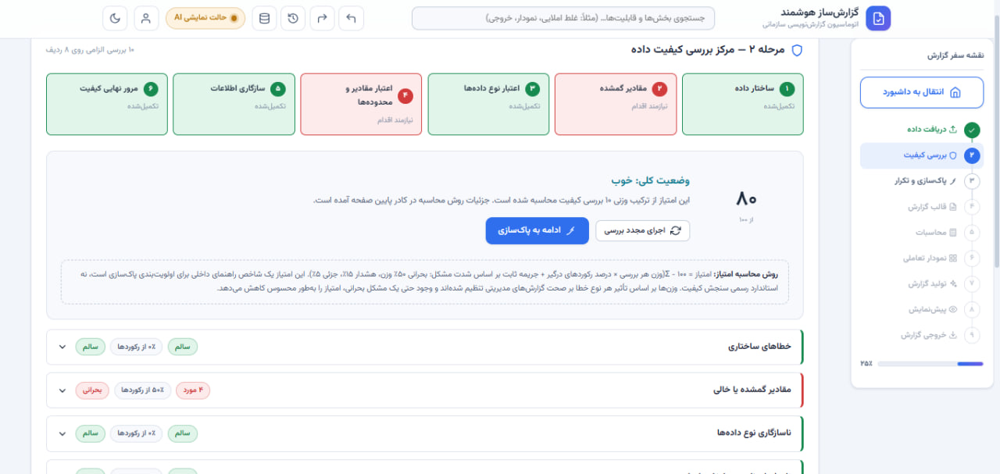
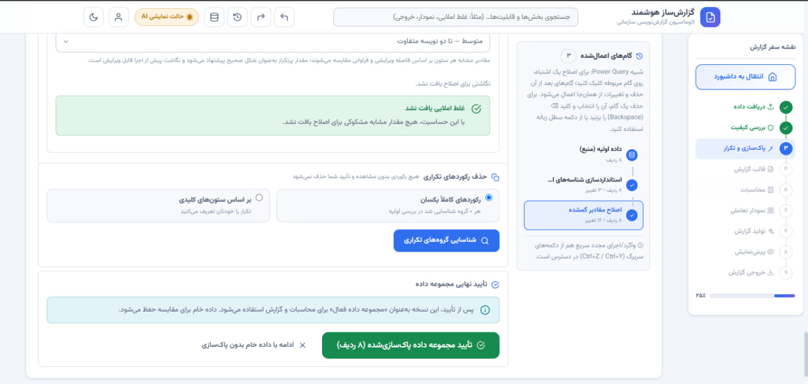
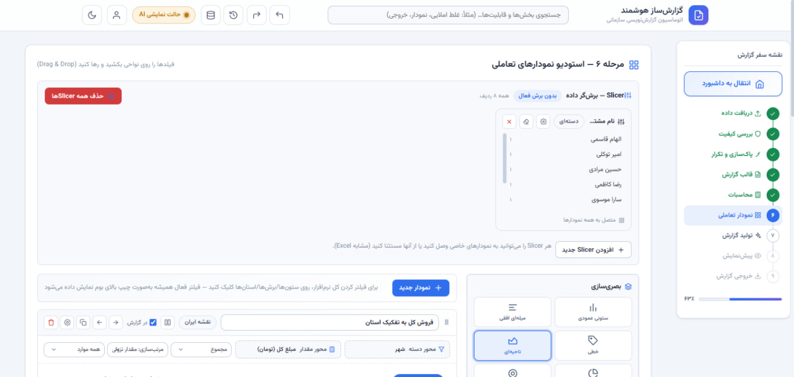
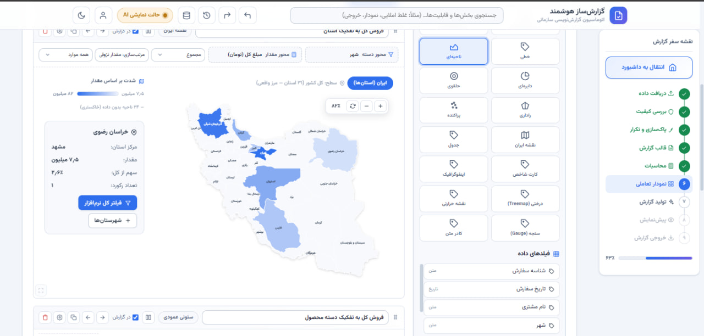
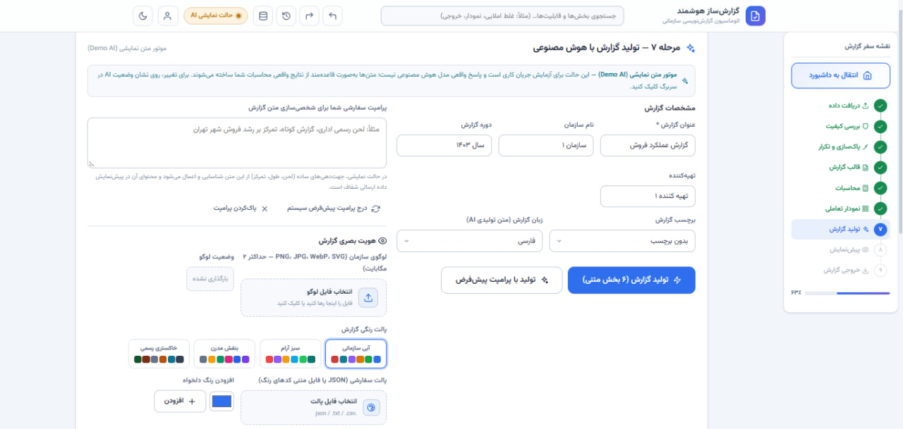
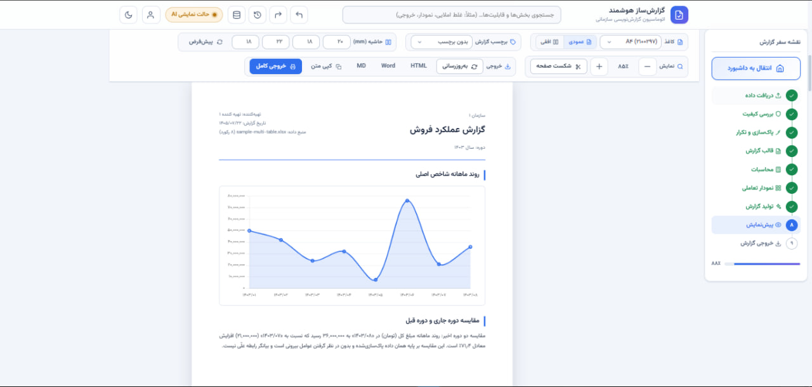

# Smart Report Automation System

> **From messy spreadsheet to decision-ready report in one workflow:** data profiling, cleaning, KPI calculation, interactive charts, and an AI-drafted narrative that a human reviews and approves.


---

## At a Glance

| | |
|---|---|
| **The problem** | After every analysis, packaging results into a report took me ~60 minutes of mechanical work: re-cleaning, re-charting, retyping numbers, re-formatting. |
| **The solution** | A local 9-step workstation that automates the repeatable parts and keeps the analyst in charge of the judgment calls. |
| **Data-analysis core** | 10-check data-quality profiler, undoable cleaning pipeline, KPI engine (13 aggregations), slicers and drill-down charts. |
| **Self-reported result** | ~60 → ~10 minutes per report in my own use (see [caveat](#impact)). |

---

## Data Analytics Capabilities

The AI is the smallest part of this project. Most of the work is the analytical pipeline underneath it.

| Stage | What it does analytically | Why it matters |
|---|---|---|
| **Import and integration** | Reads XLSX, CSV, Google Sheets links, pasted text. Detects multiple tables per sheet. Power Query-style Append and column-picker Join with live preview. | Real data rarely arrives as one clean table. |
| **Data quality profiling** | 10 automated checks and a transparent quality score across a 6-stage journey. | Problems are surfaced *before* they reach a chart or KPI. |
| **Cleaning and deduplication** | Every operation follows preview → confirm → apply, and is undoable. "Applied Steps" snapshots let you jump back to any step. Duplicate groups with a chosen retention policy. | Cleaning is auditable and reversible, not a silent overwrite. |
| **KPI engine** | `count`, `distinct`, `sum`, `mean`, `median`, `min`, `max`, `groupSum`, `groupMean`, `periodCompare`, `periodCount`, `pctFiltered`, `countFiltered`. KPIs are defined visually or in a JSON spec. | Numbers come from the dataset, never from a language model. |
| **Visual analysis** | Chart.js plus a custom SVG library (treemap, heatmap, gauge, infographic). Excel-style **slicers** for cross-chart filtering, **drill-down** on categorical charts, Iran province/county choropleth. | Lets the analyst explore, not just display. |
| **Narrative and recommendations** | The LLM drafts each section from the computed figures. The analyst edits, regenerates, rejects, or reorders. A full manual mode turns AI off. | Saves writing time without handing over the conclusions. |

### The 10 data-quality checks

Structural issues · missing values · type consistency · invalid dates · numeric range and outliers · whitespace and category inconsistencies · cross-column consistency · duplicates · overall summary · composite quality score.

<p>
  
  
</p>

---

## How I Approached the Problem

**1. Diagnose before building.** I timed my own reporting step and broke it down. The expensive part was not thinking, it was repetition: rebuilding the same charts, retyping the same figures, reapplying the same template.

**2. Separate what a machine should do from what a human must do.**

| Machine (automate) | Human (keep) |
|---|---|
| Profiling, cleaning steps, KPI computation, chart rendering, formatting, export | Deciding what the data means, accepting or rejecting AI text, final recommendations |

**3. Put data quality first.** I spent more effort on the profiler and cleaner than on the chart studio. A chart built on dirty data looks authoritative and misleads.

**4. Design the workflow as the product.** The 9-step journey is the real deliverable. Each step is useful alone, and its output is the next step's input, tracked by a single central state layer (`20-app-state.js`).

### Key design decisions and trade-offs

| Decision | Reason | Trade-off accepted |
|---|---|---|
| AI drafts, human decides. Nothing auto-publishes. | Unsupervised AI text is a failure mode in analytics. | Slower than full automation. |
| KPIs and charts computed in code. The prompt forbids invented numbers. | Figures must trace back to the data. A prompt rule reduces risk but does not guarantee correctness, so the editing layer stays. | Requires user review of every section. |
| Local-first. Server binds to `127.0.0.1`, data stays in the browser. | Business spreadsheets are often sensitive. | Single-user by design. |
| Standard-library Python, vendored JS, no build step. | Zero install friction and offline use. | Less tooling convenience. |
| Undo/Redo with a boundary at the import step. | Prevents silently wiping the active dataset. | Extra state-management complexity. |

---

## End-to-End Workflow

```
1. Import Data     →  XLSX / CSV / Google Sheets / paste · multi-table detection · Append + Join
2. Quality Check   →  10-check profiler · 6-stage journey · quality score
3. Clean & Dedupe  →  Applied steps · per-cell overrides · undoable
4. Report Template →  Built-in or custom HTML · Persian (RTL) / English (LTR)
5. Calculations    →  KPIs, grouped and period comparisons · visual or JSON spec
6. Chart Studio    →  Slicers · drill-down · treemap / heatmap / gauge / choropleth
7. Generate Report →  AI draft or manual mode · edit, regenerate, reject, reorder
8. Preview         →  Page size, margins, fonts, logo, palette, classification label
9. Export          →  PDF · DOCX · HTML · Markdown · cleaned XLSX/CSV · Google Sheets
```

<p>
  
  
</p>
<p>
  
  
</p>

---

## Impact

| Metric | Before | After |
|---|---|---|
| Time per report | ~60 min | ~10 min |
| Reduction | | ~83% (~6× faster) |

> **Caveat:** these figures come from my own initial use, not a controlled benchmark. I make no claims about financial impact, revenue, or error-rate reduction, because I have no data for them.

---

## Quick Start

Requires **Python 3.8+** and a modern browser. No `pip install` or `npm install`.

```bash
git clone https://github.com/HasanPrk/report-automation-system-v2.5.git
cd report-automation-system-v2.5/report-automation-system-v2.5
python run.py          # opens http://127.0.0.1:8586
```

Windows: double-click `start.bat`. Linux/macOS: `./start.sh`. Options: `--port 8080`, `--no-open`.

Try it immediately with the files in `samples/` (sales CSV/XLSX, multi-table XLSX, custom template example). Opening `index.html` directly also works in limited mode (no accounts, no AI key vault).

---

## Tech Stack

- **Frontend:** vanilla JavaScript (ES2020, modular), Chart.js 4.4.4, SheetJS 0.18.5, custom SVG charts, Vazirmatn font. No framework, no bundler.
- **Backend (local only):** Python `http.server`, `sqlite3`, `hashlib.scrypt`, `hmac`, `secrets`. Standard library only.
- **AI:** any OpenAI-compatible or Anthropic-compatible endpoint (OpenAI, OpenRouter, Anthropic, AvalAI, Groq, DeepSeek, local Ollama), proxied server-side so the API key never reaches the browser.

<details>
<summary><b>Architecture</b></summary>

```
Browser (index.html)  ← all import, profiling, cleaning, KPI and chart work happens here
   ├── static assets ──────►  run.py       (127.0.0.1:8586)
   ├── /api/auth/*  ───────►  appserver.py (SQLite: users, sessions, OTPs)
   └── /api/ai/chat ───────►  appserver.py (reads encrypted key → forwards to AI provider)
```

~30 JS modules in `assets/js/`, numbered by load order. Key modules:

| Module | Role |
|---|---|
| `20-app-state.js` | Central reactive state, single source of truth |
| `40-data-profiler.js` | 10-check profiler and quality score |
| `50-data-cleaner.js` | Applied-steps cleaning with snapshots |
| `29-join-engine.js` | Power Query-style merge/append |
| `80-calculation-engine.js` | KPI and aggregation engine |
| `90-ai-service.js` | Demo / manual / live modes and prompt management |
| `97-pdf-exporter.js` | PDF, DOCX, HTML, Markdown export |

</details>

<details>
<summary><b>AI provider and email setup (optional)</b></summary>

1. Open **Account → Settings** and paste your API key. It is encrypted server-side and only a masked hint is ever returned to the browser.
2. In Step 7, choose **Demo** (offline mock), **Manual** (AI off), or **Live**.
3. Enter the endpoint (a base URL such as `https://api.openai.com/v1` is auto-completed) and model name, then click **Test Connection**.

Email OTP delivery is optional. Without SMTP, the OTP is shown in the UI ("local mode"), which suits single-user use. To enable real email, set `RAS_SMTP_HOST`, `RAS_SMTP_PORT` (default 587), `RAS_SMTP_USER`, `RAS_SMTP_PASS`, `RAS_SMTP_FROM`, `RAS_SMTP_TLS` (default 1).

</details>

<details>
<summary><b>Security as implemented (not an audit)</b></summary>

Local-only server (`127.0.0.1`) · scrypt password hashing with per-user salt · HMAC-hashed OTPs · `HttpOnly` + `SameSite=Lax` session cookies (7-day TTL) · lockout after 5 failed logins · sliding-window rate limits · CSRF header check · parameterized SQL · API keys encrypted with HMAC-CTR (encrypt-then-MAC) and the master key stored outside the database · `data/` and `master.key` gitignored.

This project does **not** claim to be production-grade, audited, or penetration-tested.

</details>

---

## Limitations and Roadmap

**Known limitations**
- No automated test suite yet. Tested by manual use.
- DOCX export is HTML-in-Word (opens in Word and Google Docs, not a binary `.docx`). PDF uses the browser print dialog.
- County lines on the Iran map are Voronoi approximations from OSM centroids, not official boundaries.
- Single-user design, not built for shared deployment.

**Next steps**
- Unit tests for the calculation and join engines, end-to-end tests with Playwright
- Standalone data-quality report alongside the main report
- SQL database and REST API data sources
- Reproducible pipelines (pin dataset + template + KPI spec + chart config)

---

## How It Was Built

I defined the problem, workflow, requirements, and design rules, and reviewed and integrated the result. Code generation was done iteratively with **GLM 5.3 Flash in Agent Mode**. I list this openly because knowing how to specify, constrain, and verify AI output is part of the skill this project demonstrates.

---


## 📬 How to  Contact!

-  **Data Analyst:** Mohammadhasan Pourkabgani
-  **LinkedIn** — [MohammadHasan Pourkabgani](https://www.linkedin.com/in/mohammadhasan-pourkabgani/)
-  **GitHub** — [Hasanprk](https://github.com/Hasanprk)
-  **Email** — mh.pourkabgani91@gmail.com

Happy to walk through the architecture, the prompt strategy, or the data-quality design.
